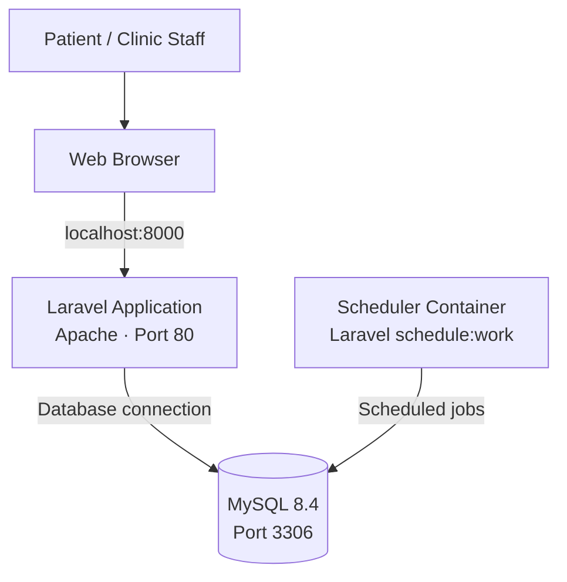
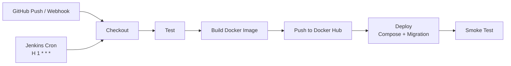

# 🏥 AntriSehat

### Smart Queue & Appointment Management for Primary Clinics

**Sistem antrean dan janji temu klinik yang dirancang untuk membuat layanan kesehatan lebih teratur, efisien, dan mudah dipantau.**

[](https://laravel.com/)
[](https://www.php.net/)
[](https://www.mysql.com/)
[](https://www.docker.com/)
[](https://www.jenkins.io/)

[Overview](#-overview) • [Features](#-key-features) • [Architecture](#-system-architecture) • [Getting Started](#-getting-started) • [CI/CD](#-cicd-pipeline) • [Team](#-team--responsibilities)

---

## 📌 Overview

**AntriSehat** adalah aplikasi manajemen nomor antrean dan janji temu untuk klinik pratama. Pasien dapat mengambil nomor antrean berdasarkan poli atau membuat janji temu dengan dokter sesuai jadwal praktik. Petugas klinik dapat memanggil antrean berikutnya, sementara pasien dapat memantau antrean yang sedang berjalan.

Proyek ini dikembangkan sebagai bagian dari **Tugas Besar 1 mata kuliah Komputasi Awan, Semester Ganjil 2026/2027 (Kelompok K05)**.

Selain membangun aplikasi, proyek ini berfokus pada penerapan praktik **DevOps dan Continuous Integration / Continuous Deployment (CI/CD)**. Aplikasi menjadi media implementasi pipeline otomatis mulai dari pengambilan source code, pengujian, pembuatan Docker image, publikasi image, deployment, hingga smoke testing.

### 🎯 Project Goals

- Mengembangkan sistem antrean dan janji temu klinik.
- Menerapkan otomatisasi pengujian dan deployment melalui Jenkins.
- Mengemas aplikasi dalam container menggunakan Docker.
- Mengelola aplikasi, database, dan scheduler menggunakan Docker Compose.
- Menyiapkan fondasi deployment lanjutan pada Azure App Service untuk Tugas Besar 2.

## ✨ Key Features

| Feature | Description |
|---------|-------------|
| 👨‍⚕️ Doctor Management | CRUD data dokter dan jadwal praktik. |
| 🏥 Queue Registration | Pasien dapat mengambil nomor antrean berdasarkan poli. |
| 📅 Appointment Booking | Membuat janji temu berdasarkan jadwal dokter yang tersedia. |
| 📢 Queue Calling | Petugas memanggil antrean berikutnya pada poli. |
| 📺 Live Queue Display | Menampilkan informasi antrean yang sedang berjalan. |
| 💚 Health Check | Memeriksa status aplikasi dan koneksi database melalui `GET /health`. |
| ⏰ Daily Queue Scheduler | Memproses antrean yang belum selesai dan menutup sesi yang telah lewat. |

> **Status:** seluruh fitur wajib PRD sudah diimplementasikan. UI memakai Blade sederhana; setiap endpoint juga mengembalikan JSON bila request mengirim header `Accept: application/json`. Autentikasi sengaja tidak dibuat (sesuai rekomendasi PRD bagian 9) agar fokus ke pipeline.

## 🧰 Tech Stack

| Technology | Version / Role | Purpose |
|------------|----------------|---------|
| Laravel | 12 | Backend application framework |
| PHP | 8.3 | Application runtime |
| MySQL | 8.4 | Relational database |
| Composer | 2.x | PHP dependency management |
| Docker | - | Application containerization |
| Docker Compose | - | Multi-container orchestration |
| Jenkins | - | CI/CD automation |
| Docker Hub | - | Container image registry |
| Ngrok | - | Public access for Jenkins webhook/demo |

Repository memakai Laravel 12 dengan `config.platform.php = 8.3.0` di `composer.json`, sehingga `composer.lock` selalu kompatibel dengan image `php:8.3-apache` walaupun developer memakai PHP lokal yang lebih baru.

## 🏗 System Architecture

AntriSehat menggunakan pendekatan multi-container agar setiap komponen memiliki tanggung jawab yang jelas.



### Container Responsibilities

| Service | Responsibility | Network |
|---------|----------------|---------|
| `app` | Menjalankan aplikasi Laravel dan melayani HTTP request. | `frontend` + `backend` |
| `db` | Menyimpan data aplikasi menggunakan MySQL. | `backend` |
| `scheduler` | Menjalankan Laravel scheduler dan job reset antrean harian. | `backend` |

**Network design:**

- `frontend` digunakan agar aplikasi dapat diakses dari host melalui port `8000`.
- `backend` menggunakan internal network untuk komunikasi aplikasi dengan database.
- Database tidak mengekspos port ke publik.
- Service scheduler tidak membutuhkan port publik.

### Application Ports

| Component | Port | Access |
|-----------|------|--------|
| Laravel Application (container) | `80` | Internal |
| Laravel Application (host) | `8000` | `http://localhost:8000` |
| MySQL | `3306` | Internal Docker network |
| Jenkins | `8080` | Jenkins host / tunnel |

## 📂 Project Structure

Struktur repository (Laravel berada di root, sesuai PRD 2.3):

```text
antrisehat-app/
├── app/
│   ├── Console/Commands/   # antrean:reset
│   ├── Enums/              # StatusAntrean, StatusJanjiTemu
│   ├── Http/Controllers/   # Health, Antrean, JanjiTemu, Dokter, JadwalDokter
│   ├── Models/
│   └── Services/           # AntreanService, JanjiTemuService, KuotaSesiService
├── bootstrap/
├── config/
├── database/
│   ├── migrations/
│   └── seeders/
├── docker/                 # apache vhost & php.ini
├── docs/                   # PRD
├── public/
├── resources/
├── routes/
├── tests/                  # Automated tests
├── storage/
├── Dockerfile              # Multi-stage Docker build
├── compose.yaml            # Application, database & scheduler
├── Jenkinsfile             # CI/CD pipeline definition
├── .dockerignore
├── .env.example
├── .gitignore
└── README.md
```

## 🚀 Getting Started

### Prerequisites

Pastikan perangkat telah memiliki:

- Git.
- Docker Engine dan Docker Compose v2.
- (Opsional, untuk menjalankan tanpa Docker) PHP 8.3, Composer 2.x, dan MySQL 8.4.

### 1. Clone Repository

```bash
git clone https://github.com/Zhacksdev/antrisehat-app.git
cd antrisehat-app
```

### 2. Configure Environment

Salin file environment example:

```bash
cp .env.example .env
```

Sesuaikan konfigurasi `.env` dengan environment lokal. Contoh konfigurasi untuk Docker Compose:

```env
APP_NAME=AntriSehat
APP_ENV=local
APP_DEBUG=true
APP_URL=http://localhost:8000
APP_TIMEZONE=Asia/Jakarta
LOG_CHANNEL=stderr

DB_CONNECTION=mysql
DB_HOST=db
DB_PORT=3306
DB_DATABASE=antrisehat
DB_USERNAME=antrisehat
DB_PASSWORD=change-this-password
DB_ROOT_PASSWORD=change-this-root-password

DOCKERHUB_USER=your-dockerhub-username
IMAGE_TAG=latest
```

> Gunakan secret yang kuat untuk deployment. Jangan commit file `.env`, password, `APP_KEY`, atau credential ke repository.

### 3. Build and Run Containers

```bash
docker compose up -d --build
```

Periksa status container:

```bash
docker compose ps
```

Lihat log aplikasi:

```bash
docker compose logs -f app
```

### 4. Run Database Migration and Seeder

Jalankan migrasi setelah database siap:

```bash
docker compose run --rm app php artisan migrate --force
```

Isi data awal (3 poli, dokter beserta jadwal, dan pasien contoh):

```bash
docker compose run --rm app php artisan db:seed --force
```

### 5. Access the Application

Buka aplikasi melalui browser:

```text
http://localhost:8000
```

Periksa health endpoint:

```bash
curl -i http://localhost:8000/health
```

Contoh respons ketika aplikasi dan database tersedia:

```json
{
  "status": "ok",
  "database": "connected",
  "timestamp": "2026-11-17T08:00:00+07:00"
}
```

Endpoint mengembalikan HTTP `200` ketika database terhubung dan HTTP `503` ketika database tidak dapat dijangkau.

## ⚙️ Environment Variables

| Variable | Description |
|----------|-------------|
| `APP_NAME` | Nama aplikasi. |
| `APP_ENV` | Environment aplikasi. |
| `APP_KEY` | Encryption key Laravel. |
| `APP_DEBUG` | Mengaktifkan atau menonaktifkan debug mode. |
| `APP_URL` | Base URL aplikasi. |
| `APP_TIMEZONE` | Zona waktu aplikasi, direkomendasikan `Asia/Jakarta`. |
| `LOG_CHANNEL` | Tujuan output log, direkomendasikan `stderr` untuk Docker. |
| `DB_CONNECTION` | Driver database (`mysql`). |
| `DB_HOST` | Nama service database pada Compose (`db`). |
| `DB_PORT` | Port database (`3306`). |
| `DB_DATABASE` | Nama database (`antrisehat`). |
| `DB_USERNAME` | Username database. |
| `DB_PASSWORD` | Password database. |
| `DB_ROOT_PASSWORD` | Password root MySQL. |
| `DOCKERHUB_USER` | Username Docker Hub untuk image. |
| `IMAGE_TAG` | Tag Docker image yang digunakan. |
| `ANTRISEHAT_RESET_CRON` | (Opsional) Jadwal cron untuk job reset antrean; untuk demo isi `* * * * *`. |

Daftar lengkap dan nilai contohnya ada di `.env.example`.

## 🗃️ Database Design

| Table | Main Attributes | Purpose |
|-------|-----------------|---------|
| `polis` | `id`, `nama`, `kode` | Data poli klinik. |
| `dokters` | `id`, `nama`, `poli_id` | Data dokter. |
| `jadwal_dokters` | `dokter_id`, `hari`, `jam_mulai`, `jam_selesai`, `maks_pasien` | Jadwal praktik dokter. |
| `pasiens` | `id`, `nama`, `no_hp` | Data pasien. |
| `antreans` | `poli_id`, `pasien_id`, `tanggal`, `nomor`, `status` | Data nomor antrean. |
| `janji_temus` | `dokter_id`, `jadwal_dokter_id`, `pasien_id`, `tanggal`, `jam_mulai`, `jam_selesai`, `status` | Data janji temu. |

### Business Rules

Sistem mengikuti aturan bisnis berikut:

1. **Sequential Queue Number** — Nomor antrean berurutan untuk setiap poli dan dimulai kembali dari nomor `1` pada hari berikutnya.
2. **Valid Appointment Schedule** — Janji temu hanya dapat dibuat pada slot jadwal praktik dokter.
3. **No Appointment Conflict** — Janji temu tidak boleh bentrok pada dokter dan slot waktu yang sama.
4. **Session Capacity** — Maksimal 30 pasien dalam satu sesi dokter.
5. **Daily Queue Cleanup** — Antrean hari sebelumnya yang masih berstatus `MENUNGGU` diproses menjadi `KEDALUWARSA`.

Untuk menjaga konsistensi nomor antrean, tabel `antreans` memakai unique constraint pada kombinasi `(poli_id, tanggal, nomor)` dan transaksi database dengan locking saat menentukan nomor berikutnya.

## 🔌 Main Endpoints

| Method | Endpoint | Description |
|--------|----------|-------------|
| `GET` | `/health` | Memeriksa kesehatan aplikasi dan koneksi database. |
| `CRUD` | `/dokters` | Mengelola data dokter. |
| `CRUD` | `/jadwal-dokters` | Mengelola jadwal praktik dokter. |
| `POST` | `/antrean` | Mengambil nomor antrean berdasarkan poli. |
| `POST` | `/antrean/panggil` | Memanggil antrean berikutnya. |
| `GET` | `/antrean/berjalan` | Menampilkan antrean yang sedang berjalan. |
| `POST` | `/janji-temu` | Membuat janji temu dokter. |

Semua route berada di `routes/web.php`. Halaman tambahan: `GET /` (ambil dan panggil antrean) dan `GET /janji-temu` (form dan daftar janji temu).

Contoh request JSON:

```bash
# Ambil nomor antrean
curl -X POST http://localhost:8000/antrean -H "Accept: application/json" -d "poli_id=1"

# Panggil antrean berikutnya
curl -X POST http://localhost:8000/antrean/panggil -H "Accept: application/json" -d "poli_id=1"

# Buat janji temu (jam_selesai opsional, default 15 menit)
curl -X POST http://localhost:8000/janji-temu -H "Accept: application/json" \
  -d "jadwal_dokter_id=1&tanggal=2026-11-23&jam_mulai=08:00&nama=Budi&no_hp=0811111111"
```

Endpoint `POST /antrean`, `/antrean/panggil`, dan `/janji-temu` dikecualikan dari CSRF (lihat `bootstrap/app.php`) karena aplikasi tidak memakai autentikasi, sehingga dapat dipanggil langsung lewat curl.

## 🧪 Testing

Pengujian otomatis menjadi bagian penting dari pipeline CI/CD untuk memastikan aplikasi tetap berjalan sesuai kebutuhan.

### Test Scenarios

| No. | Scenario | Expected Result |
|-----|----------|-----------------|
| 1 | Health endpoint memeriksa koneksi database. | HTTP `200` saat database terhubung. |
| 2 | Pasien mengambil antrean pada poli yang sama. | Nomor antrean berurutan. |
| 3 | Antrean dibuat pada hari berikutnya. | Nomor dimulai kembali dari `1`. |
| 4 | Janji temu dibuat di luar jadwal dokter. | Permintaan ditolak. |
| 5 | Janji temu bentrok pada dokter dan slot yang sama. | Permintaan ditolak. |
| 6 | Pasien ke-31 mendaftar pada satu sesi dokter. | Permintaan ditolak. |
| 7 | Petugas memanggil antrean berikutnya. | Status antrean diperbarui. |
| 8 | Command reset memproses antrean lama. | Antrean yang memenuhi kondisi ditandai kedaluwarsa. |

Seluruh skenario di atas (ditambah test respons 503 untuk `/health`, CRUD dokter dan jadwal, serta registrasi scheduler) berada di folder `tests/Feature`.

Jalankan test Laravel (memakai SQLite in-memory dari `phpunit.xml`):

```bash
composer install
php artisan test
```

Untuk menjalankan test melalui Docker sesuai rancangan multi-stage build:

```bash
docker build --target test -t antrisehat:test .
```

Untuk pengujian yang bergantung pada locking dan unique constraint, gunakan MySQL agar perilakunya mendekati production.

## 🔄 CI/CD Pipeline

AntriSehat menggunakan Jenkins untuk mengotomatisasi proses integrasi dan deployment aplikasi.

### Pipeline Flow



### Jenkins Credentials

| ID | Jenis | Isi |
|----|-------|-----|
| `dockerhub-credentials` | Username with password | Akun / access token Docker Hub |
| `antrisehat-env` | Secret file | File `.env` production |

Agent Jenkins membutuhkan Docker Engine + Docker Compose v2. Stage Smoke Test memanggil `http://localhost:8000/health`, sehingga deploy dan Jenkins harus berada di host Docker yang sama (bila Jenkins berjalan di dalam container, mount `/var/run/docker.sock` dan sesuaikan `HEALTH_URL`).

### Pipeline Stages

| Stage | Responsibility |
|-------|----------------|
| Checkout | Mengambil source code dari GitHub. |
| Test | `docker build --target test`: install dependency lalu menjalankan `php artisan test`. |
| Build | Membuat Docker image aplikasi. |
| Push | Mengirim image ke Docker Hub. |
| Deploy | Menjalankan atau memperbarui service melalui Docker Compose dan menjalankan migrasi database setelah database siap. |
| Smoke Test | Memastikan aplikasi merespons melalui `/health`. |

### Scheduled Jenkins Build

Selain webhook GitHub, Jenkins memiliki trigger terjadwal:

```groovy
triggers {
    cron('H 1 * * *')
}
```

Trigger ini membangun ulang pipeline setiap malam. Tanggung jawabnya berbeda dengan scheduler aplikasi.

### Daily Queue Scheduler

Container `scheduler` menjalankan:

```bash
php artisan schedule:work
```

Command reset antrean:

```bash
php artisan antrean:reset
```

Jadwal pada Laravel:

```php
Schedule::command('antrean:reset')
    ->dailyAt('00:00')
    ->withoutOverlapping();
```

Jadwal dapat diubah lewat `ANTRISEHAT_RESET_CRON` di `.env`. Untuk demo, isi `ANTRISEHAT_RESET_CRON="* * * * *"` lalu restart scheduler agar job berjalan tiap menit. Reset manual:

```bash
docker compose exec scheduler php artisan antrean:reset
```

Periksa log scheduler untuk bukti eksekusi:

```bash
docker compose logs -f scheduler
```

> Jenkins cron bertanggung jawab atas pipeline CI/CD terjadwal, sedangkan Laravel scheduler bertanggung jawab atas pemrosesan antrean harian. Keduanya merupakan mekanisme yang berbeda.

## 👥 Team & Responsibilities

Project dikerjakan oleh Kelompok K05 dengan pembagian tanggung jawab berikut:

| Member | Role | Responsibilities |
|--------|------|------------------|
| Jeki | Tech Lead / Backend | Arsitektur aplikasi, fitur backend, database, endpoint, dan aturan bisnis. |
| Devina | DevOps Engineer | Jenkins, CI/CD pipeline, webhook, Ngrok, credentials, dan deployment workflow. |
| Aura | Container Engineer | Dockerfile, Docker Compose, container, network, database service, dan scheduler. |
| Alysa | QA & Tech Writer | Automated testing, skenario pengujian, dokumentasi, diagram, dan laporan. |

## 🗺 Project Timeline

| Week | Focus |
|------|-------|
| Week 9 | Kickoff, repository, Laravel foundation, health endpoint, Dockerfile, dan Compose lokal. |
| Week 10 | Jenkins, Ngrok, GitHub webhook, dan pipeline CI/CD. |
| Week 11 | Implementasi fitur, business tests, scheduler, dan pengujian recovery. |
| Week 12 | Final report, validasi demo, dan presentasi. |

## 🔐 Security Notes

- Jangan menyimpan `.env` atau credential di Git.
- Gunakan `.env.example` hanya untuk mendokumentasikan nama variabel dan placeholder.
- Pastikan `APP_DEBUG=false` pada production.
- Gunakan password database yang kuat.
- Jangan mengekspos port database ke jaringan publik.
- Simpan credential Docker Hub dan deployment di Jenkins Credentials.
- Batasi akses Jenkins dan endpoint deployment sesuai kebutuhan.

## 📚 Project Documentation

- **Product Requirements Document (PRD):** lihat folder [`docs/`](docs/).
- **Repository:** [github.com/Zhacksdev/antrisehat-app](https://github.com/Zhacksdev/antrisehat-app)
- **Framework Documentation:** [Laravel Documentation](https://laravel.com/docs)
- **Container Documentation:** [Docker Documentation](https://docs.docker.com/)
- **CI/CD Documentation:** [Jenkins Documentation](https://www.jenkins.io/doc/)

## 🚧 Project Status

| Area | Status |
|------|--------|
| Kerangka Laravel 12 + `/health` | ✅ |
| Model data, migrasi, seeder | ✅ |
| Fitur antrean, panggil, janji temu | ✅ |
| CRUD dokter & jadwal praktik | ✅ |
| Aturan bisnis + test otomatis | ✅ |
| Command `antrean:reset` + scheduler | ✅ |
| Dockerfile multi-stage + compose | ✅ |
| Jenkinsfile (pipeline CI/CD) + cron trigger | ✅ |
| Setup Jenkins, Ngrok, webhook | ⏳ (konfigurasi server) |

---

**Built with ❤️ by Team K05**

*AntriSehat — Better Queue, Better Care.*